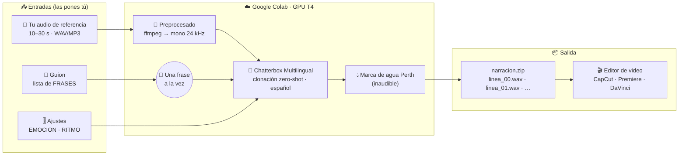

# 🎙️ Narrador con tu propia voz (español)

Notebook de Google Colab para narrar videos cortos (YouTube Shorts, TikTok, Reels) con **tu propia voz**, frase por frase, usando [Chatterbox Multilingual](https://github.com/resemble-ai/chatterbox) (licencia MIT). Gratis, con la GPU de Colab.

**Creado por Eduardo Rincón.**

## Arquitectura

**Cómo funciona:**
1. **Preprocesado:** `ffmpeg` convierte tu audio a mono de 24 kHz, el formato que espera el modelo.
2. **Clonación zero-shot:** Chatterbox toma las características de tu voz directamente del audio, sin entrenar nada. Por eso basta con unos segundos de grabación.
3. **Generación por frase:** cada frase del guion se sintetiza por separado. Así puedes regenerar solo la que no quedó bien y acomodar cada audio en la línea de tiempo del video.
4. **Marca de agua:** el modelo agrega una marca inaudible (Perth) que identifica el audio como sintético.
5. **Salida:** un `.wav` por frase, empaquetados en un `.zip` listo para el editor.

> 🔒 **Privacidad:** tu audio de referencia vive solo en tu sesión de Colab y se borra cuando cierras la sesión. Nada se sube a este repositorio ni a ningún servidor del autor.

## Cómo se usa
1. Abre el notebook en Colab y activa **GPU T4** (Entorno de ejecución → Cambiar tipo de entorno).
2. **Ejecutar todo**. La primera vez la sesión se reinicia sola tras instalar: vuelve a darle **Ejecutar todo**.
3. Sube un audio tuyo de 10–30 segundos (sin música ni ruido de fondo).
4. Escribe tu guion en la celda 3, una frase por línea.
5. Ajusta **EMOCION** y **RITMO** con la celda de prueba y genera todo: se descarga un `.zip` con un `.wav` por frase.

## Uso responsable
- Usa solo tu voz o la de alguien que te dio permiso explícito.
- No lo uses para suplantar, engañar o hacer fraudes.
- Los audios generados llevan una marca de agua inaudible (Perth) que permite detectar que son sintéticos.

## Licencia y créditos
- Este notebook: **[CC BY-NC 4.0](LICENSE)** © 2026 Eduardo Rincón. Puedes usarlo, modificarlo y compartirlo **dando crédito** al autor. **No se permite venderlo** ni usarlo como parte de un producto pagado sin permiso.
- Los audios que generes con tu propia voz son tuyos y puedes usarlos en tus videos, incluidos los monetizados.
- Modelo: Chatterbox de [Resemble AI](https://github.com/resemble-ai/chatterbox), licencia MIT (se instala desde su paquete oficial; no se redistribuye aquí).
